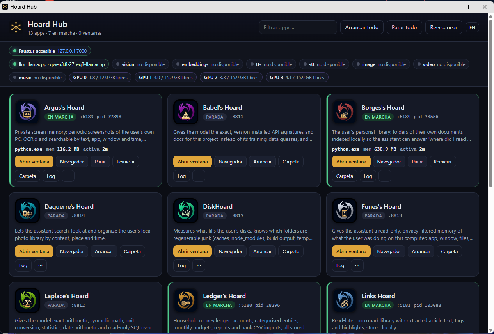
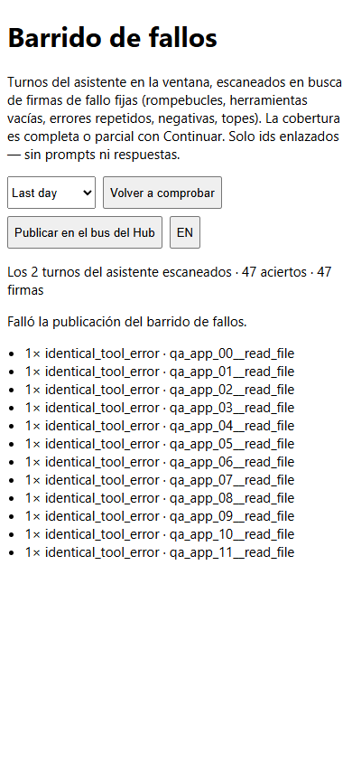

# Hoard Hub

Hoard Hub es el centro de control de escritorio de la familia Hoard de aplicaciones locales, y la casa de Hoard Link, la librería pequeña de Python (`hoard_link`) que cada aplicación lleva copiada para encontrar y llamar a los modelos de IA locales.

[English](README.md)



## Qué es

El repositorio reúne las dos mitades de una misma idea.

**Hoard Link** es una librería (biblioteca estándar más `httpx`; sin servidor, sin puerto, sin interfaz) que responde una pregunta a cualquier aplicación: para la capacidad X (`llm`, `vision`, `embeddings`, `tts`, `stt`, `image`, `video`, `music`), ¿qué servidor y qué modelo uso ahora mismo, y por qué? Prefiere los servidores que ya están en marcha, de modo que una máquina limitada por GPU nunca carga una segunda copia de un modelo ni molesta a lo que la persona esté haciendo en Faustus.

**Hoard Hub** es un servidor en loopback con su propia ventana de escritorio. Muestra una tarjeta por aplicación de la familia (leída del `faustus-plugin.json` de cada una), las arranca, las para y las abre, reparte las GPU entre ellas y hace de sistema nervioso de la familia: eventos, reglas, tareas programadas, copias de seguridad, avisos, correo, agenda, búsqueda y el Ágora, donde los agentes de código se coordinan.

## Qué hace Hoard Link

- Resuelve un servidor de modelo por capacidad en un orden fijo: configuración explícita (`backend.json`, variables `HOARD_*`), el registro de modelos de Faustus (solo entradas locales o de la red privada; los endpoints en la nube se ignoran) y sondeos en loopback de llama.cpp, Ollama, servidores compatibles con OpenAI y ComfyUI. Si nada resuelve devuelve `unavailable` con los motivos, listos para una pantalla de Ajustes.
- Llama al servidor encontrado: `chat` (texto y visión, con plazos que distinguen espera inicial, inactividad y duración total), `embed`, `tts` y un `ComfyClient` para grafos de imagen y vídeo. El razonamiento se separa de la respuesta y `effort` (off, low, medium, high, max) se traduce a los controles nativos de pensamiento de cada servidor.
- Usa solo modelos residentes por defecto (`only_resident`), comprueba que el modelo tenga la capacidad pedida y puede esperar a un llama-server ocupado (`wait_idle`) para que los trabajos de fondo cedan ante el primer plano.
- Ordena los candidatos con rutas medidas: una app de pruebas escribe `~/.hoard/routes.json` con el mejor modelo por tarea y `task="code"` elige en consecuencia. Las rutas solo ordenan; nunca cargan un modelo ni sustituyen una URL explícita.
- Pide al Hub reservas de memoria de GPU (`lease(vram_mb=..., gpu=[2, 3])`) para que dos programas no cuenten los mismos gigas libres, y carriles de navegador (`lane(url)`) para que solo una app a la vez maneje un sitio. Sin Hub, ambos degradan sin ruido a un comportamiento local.
- Arranca backends por su cuenta cuando Faustus no está (`hoard_link.launch`: ComfyUI, Ollama, comandos propios).
- Sirve datos públicos en vivo con caché que aguanta los fallos de la fuente (`hoard_link.livefeed`).
- Incluye las piezas comunes de la familia: clientes de avisos, correo, agenda, referencias y descarga web (`fam_*`), el panel copiloto de Faustus para cada app (`install_spa`), el mapa español/inglés de nombres de Pokémon, un kit de pruebas diferenciales de paridad y el tema común.

Límites: sin generación de música por sondeo, sin progreso por websocket en ComfyUI, `tts` necesita Faustus o un comando configurado, y la configuración explícita se da por buena (una dirección obsoleta aparece como `BackendError` en la primera llamada).

## Qué hace Hoard Hub

**Aplicaciones**
- Una tarjeta por app: icono, nombre, propósito, puerto y estado (en marcha, arrancando, parada, puerto ocupado), más el proceso tras el puerto (pid, memoria, tiempo en marcha, hijos).
- Acciones: Abrir ventana, Navegador, Arrancar, Parar (solo cuando la comprobación de salud demuestra que quien escucha es esa app), Reiniciar, Cerrar ventanas, Carpeta, Registro, y Arrancar todo / Parar todo. Las paradas manuales sobreviven a los reinicios del Hub.
- Perfiles: conjuntos con nombre de apps, comandos externos (un ComfyUI por GPU, un llama-server) y ventanas de escritorio que se arrancan o paran a la vez, con exportación e importación en JSON.
- `launch_overrides` permite que una máquina arranque una app de forma distinta a su manifiesto, por ejemplo una compilación de desarrollo.
- Arranque al iniciar sesión en Windows sin permisos de administrador.
- Una barra de estado en cada página con Faustus (en marcha, puerto, abrir, arrancar, parar), cuántos Hoards corren y un medidor por GPU.

**Hoard Window y tema común**
- Cada app se abre como el mismo tipo de ventana de escritorio sin marco (un pequeño shell de Electron en `shell/`, o una ventana de aplicación de Chromium) con su propio perfil, entrada en la barra de tareas y tamaño recordado.
- `hoard-theme.css` lleva los tokens de diseño comunes y una paleta por app; un script sincroniza todas las copias vendorizadas.

**GPU y navegadores**
- Un panel de GPU con memoria usada, reservada y disponible por GPU, reservas concedidas y en cola, GPU protegidas y un botón Liberar.
- Un panel de carriles de navegador con un carril por dominio y por perfil de navegador.

**Ejecutar en: este PC o una Spark**
- Faustus, Hermes y Prometheus pueden pasar a una DGX Spark y volver, con copia incremental de datos, reescritura de ajustes, comprobaciones de salud, negativa a arrancarlos en el PC mientras viven en la Spark y un cambio de un clic en la cabecera. El estado remoto se consulta en segundo plano y un túnel SSH inverso mantiene el Hub accesible desde Faustus.
- El Hub también retransmite por HTTP el MCP por stdio de cada app instalada, para que un Faustus en una Spark use apps del PC o de una Spark.

**Capa de familia**
- Bus de eventos, llamadas entre apps, reglas (cuando un evento coincide, ejecuta una acción), tareas programadas, copias deduplicadas de los datos de cada app con verificación y restauración, y auditoría de la familia.
- Más de doce facetas, cada una con su pestaña y sus herramientas: esferas (personal, trabajo, autónomo, cada una con sus cuentas, horas de silencio y enrutado), avisos (Windows, ntfy, Telegram, correo), una sola lectura del correo para toda la familia, chats de Slack y Microsoft 365, Hoy (agenda, resumen matinal, calendario suscribible), referencias entre registros, búsqueda entre apps, seguimiento de trabajos largos, compras, un descargador web educado y compartido, reglas del Cerebro hacia Faustus, sesiones de agentes con deshacer, nombres es/en y pruebas de paridad.
- Pestaña Repos: commits sin subir, árboles sucios, ramas sueltas, copias vendorizadas desfasadas, falta de README o LICENSE, CI fallando y secretos rastreados, solo en lectura.
- Modelos para todas las apps por HTTP (`/api/link/chat`, `/api/link/status`), de modo que las apps de Node comparten la misma resolución, reservas y esfuerzo de razonamiento.
- Instancias: una segunda copia de una app sobre otra carpeta de datos puede hablar como la app.
- Vista de flota que concilia apps declaradas, tareas, reglas y vigilantes en Hoy, Esperándote, Bloqueado y En pausa.

**Ágora**
- El espacio de trabajo compartido de los agentes de código y la persona: latidos, tareas (abierta, reclamada, en curso, revisión, aprobada, hecha) con bloqueos de todo o nada, hilos, debates con evidencias, registro de decisiones, revisiones ligadas a la revisión de la entrega, puntos de control, cronologías y un buzón con long poll.
- Los espacios se leen como servidores de chat, con canales, menciones, reacciones, archivos, miembros y rangos.
- Una vista en directo con un cursor por agente activo, un observador de las transcripciones de Codex, Cursor y Claude Code, y una consola nativa en Tauri (también en `/agora/`) que lanza sesiones de trabajo de cada proveedor, incluidos trabajadores de Faustus, con recibos, continuar y detener.
- Referencia: `docs/AGORA.md`.

## Cómo ejecutarlo

Requisitos: Python 3.11 o superior, `httpx`; `psutil` para el control de procesos; `pywebview` opcional para una ventana nativa; Node para el shell de Hoard Window.

```powershell
git clone https://github.com/Luissalet/HoardLink.git
cd HoardLink
py -m venv .venv
.venv\Scripts\Activate.ps1
pip install -e ".[dev]"
python examples/status.py            # qué resuelve cada capacidad, y por qué
```

El Hub:

```powershell
python -m hoard_link.hub                      # servidor en 127.0.0.1:8810 y ventana de escritorio
python -m hoard_link.hub --no-window          # solo servidor
python -m hoard_link.hub --profile video      # arranca un perfil cuando esté listo
python -m hoard_link.hub --install-autostart  # arranca al iniciar sesión en Windows (también --uninstall-autostart)
```

En Windows, doble clic en `Hoard Hub.cmd`. La configuración vive en `data/hub.json` (`roots`, `browser`, `window_engine`, `faustus_dir`, `profiles`, `launch_overrides`, `lease_headroom_mb`, `language`, `repos` y más) o en variables `HOARD_HUB_*`. Cerrar la ventana para el Hub; las apps que arrancó siguen funcionando.

Usar Hoard Link en una app: copia entero el directorio `hoard_link/` dentro de la app (sin editar la copia) y usa

```python
from hoard_link import Link, LinkConfig
link = Link(LinkConfig.load(path_to_backend_json, env=os.environ, app="argus"))
text = await link.chat([{"role": "user", "content": "..."}], task="code", effort="low")
```

`backend.json` y las variables `HOARD_<CAP>_URL`, `HOARD_<CAP>_MODEL`, `HOARD_FAUSTUS_URL` y `HOARD_FAUSTUS_TOKEN` mandan sobre el descubrimiento. Detalles: `docs/HUB.md`, `docs/FAMILY.md`.

## Conexión con Faustus

- Hoard Link encuentra Faustus en `127.0.0.1:7000` o `:7001`, lee su registro de modelos y habla directamente con los servidores que ya tiene cargados. Si Faustus exige autenticación, pon un token con ámbito `chat` en `backend.json` bajo `faustus.token` o en `HOARD_FAUSTUS_TOKEN`.
- El repositorio incluye un `faustus-plugin.json`, así que Faustus adopta el Hub como cualquier otra app. Su bloque `skills` nombra los procedimientos de la biblioteca de skills de la familia que encajan con el Hub.
- Los agentes manejan el Hub por `GET /api/agent/tools` y `POST /api/agent/call` con el token bearer de `data/mcp-token`, o por el puente stdio `python -m hoard_link.hub.mcp`, que arranca un Hub sin ventana si no hay ninguno escuchando.
- Herramientas MCP por grupos: apps y perfiles (`hub_list_apps`, `hub_start_app`, `hub_stop_all`, `hub_profile_*`), GPU y carriles (`hub_lease_*`, `hub_lane_*`), instancias, capa de familia (`hub_events`, `hub_rule_*`, `hub_job_*`, `hub_backup_*`, `hub_family_audit`, `hub_call_app`), repos (`hub_repos`, `hub_repo_*`), acceso a modelos (`hub_link_status`, `hub_link_chat`), colocación (`hub_placement_*`), flota y búsqueda de capacidades (`hub_fleet_status`, `hub_capability_find`), correo (`hub_mail_accounts`, `hub_mail_compose`), relés MCP (`hub_mcp_apps`) y el Ágora (`hub_agora_*`, unas ochenta herramientas). `scripts/agora.py` ofrece las mismas operaciones del Ágora a agentes que solo tienen terminal.
- La ventana del propio Hub lleva el panel copiloto compartido de Faustus.

## Capturas

La captura de arriba es la vista general del Hub. `qa276-r2-ui-es-mobile.png` muestra la disposición móvil en español.

<details>
<summary>Disposición móvil</summary>



</details>

## Estructura

| Ruta | Contenido |
|---|---|
| `hoard_link/` | La librería: resolución, chat, embeddings, TTS, ComfyUI, reservas, carriles, arranque, livefeed, clientes `fam_*` |
| `hoard_link/hub/` | El servidor del Hub, facetas, colocación, Ágora e interfaz web |
| `apps/agora/` | La consola nativa del Ágora (Tauri) |
| `shell/` | Hoard Window, el shell Electron común |
| `js/` | Contrapartes en Node (`hoard-link.js`, `hoard-commons`) |
| `docs/` | Referencia: HUB, FAMILY, AGORA, facetas, commons |
| `scripts/` | Sincronización de tema y vendor, paletas, auditoría de cohesión, `agora.py` |
| `examples/` | `status.py` |
| `tests/` | La batería de pytest |
| `data/` | Configuración del Hub, tokens, registros, base del Ágora, copias (no se versiona) |

## Tests

```powershell
pytest -q
```

La batería corre sin conexión con transportes simulados y pequeños servidores HTTP locales; no necesita GPU, red ni modelos descargados.

## Licencia

MIT, ver [LICENSE](LICENSE).
