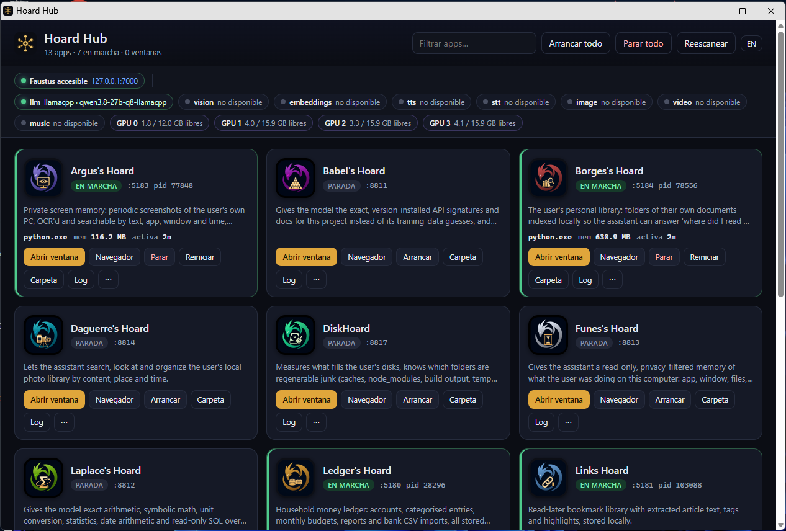

# Hoard Hub

Hoard Hub is the desktop control centre of the Hoard family of local apps, and the home of Hoard Link, the small Python library (`hoard_link`) that every app vendors to find and call the local AI models.

[Español](README.es.md)



## What it is

The repository holds two halves of one idea.

**Hoard Link** is a library (standard library plus `httpx`; no server, no port, no UI) that answers one question for any app: for capability X (`llm`, `vision`, `embeddings`, `tts`, `stt`, `image`, `video`, `music`), which server and which model do I use right now, and why? It prefers servers that are already running, so a GPU-bound machine never loads a second copy of a model, and it never disturbs what the person is doing in Faustus.

**Hoard Hub** is a loopback server with its own desktop window. It shows one card per app of the family (read from each app's `faustus-plugin.json`), starts, stops and opens them, shares the GPUs between them, and acts as the family's nervous system: events, rules, jobs, backups, notifications, mail, agenda, search and the Agora workspace where coding agents coordinate.

## What Hoard Link does

- Resolves a model server per capability in a fixed order: explicit configuration (`backend.json`, `HOARD_*` environment), the Faustus model registry (local and private-network entries only; cloud endpoints are ignored), then loopback probes for llama.cpp, Ollama, OpenAI-compatible servers and ComfyUI. If nothing resolves it returns `unavailable` with the reasons, fit for a Settings screen.
- Calls the server it found: `chat` (text and vision, with streaming-aware timeouts), `embed`, `tts`, and a `ComfyClient` for image and video graphs. Reasoning is separated from the answer, and `effort` (off, low, medium, high, max) maps to each server's native thinking controls.
- Uses only resident models by default (`only_resident`), checks that a model has the requested capability, and can wait for a busy llama-server (`wait_idle`) so background jobs yield to the foreground.
- Orders candidates by measured routes: a benchmarking app writes `~/.hoard/routes.json` with the best model per task, and `task="code"` picks accordingly. Routes only rank; they never load a model or override an explicit URL.
- Takes GPU memory leases from the Hub (`lease(vram_mb=..., gpu=[2, 3])`) so two programs never take the same free gigabytes, and browser lanes (`lane(url)`) so only one app at a time drives a given site. Without a hub both degrade quietly to local behaviour.
- Starts backends on its own when Faustus is not around (`hoard_link.launch`: ComfyUI, Ollama, custom commands).
- Serves live public data with a stale-while-failing cache (`hoard_link.livefeed`).
- Includes the shared building blocks of the family: notification, mail, agenda, references and web-fetch clients (`fam_*`), the Faustus copilot panel for every app (`install_spa`), the shared Spanish/English name map for Pokémon data, a differential parity test kit and the common theme.

Limits: no music generation through probing, no websocket progress for ComfyUI, `tts` needs Faustus or a configured command, and an explicit configuration is trusted as given (a stale address shows up as a `BackendError` on the first call).

## What Hoard Hub does

**Apps**
- One card per app: icon, name, purpose, port and state (running, starting, stopped, port busy), plus the process behind the port (pid, memory, uptime, children).
- Actions: Open window, Browser, Start, Stop (only when the health check proves the listener is that app), Restart, Close windows, Folder, Log, and Start all / Stop all. Manual stops persist across restarts of the Hub.
- Profiles: named sets of apps, external commands (a ComfyUI per GPU, a llama-server) and desktop windows started or stopped together, with JSON export and import.
- `launch_overrides` let a machine start an app differently from its manifest, for example a developer build.
- Autostart at Windows login without admin rights.
- A status bar on every page with Faustus (running, port, open, start, stop), the number of running Hoards and one meter per GPU.

**Hoard Window and shared theme**
- Every app opens as the same kind of frameless desktop window (a small Electron shell in `shell/`, or a Chromium app window) with its own profile, taskbar entry and remembered size.
- `hoard-theme.css` carries the shared design tokens and one palette per app; a script syncs every vendored copy.

**GPU and browsers**
- A GPU panel with per-GPU used, reserved and available memory, granted and queued leases, protected GPUs and a Release button.
- A Browser lanes panel with one lane per site domain and per browser profile.

**Run on: this PC or a Spark**
- Faustus, Hermes and Prometheus can move to a DGX Spark and back, with incremental data copy, settings rewrite, health checks, a refusal to start them on the PC while they live on the Spark, and a one-click switch in the header. Remote state is polled in the background, and a reverse SSH tunnel keeps the Hub reachable from Faustus.
- The Hub also relays each installed app's stdio MCP over HTTP so Faustus on a Spark can use apps on the PC or on a Spark.

**Family layer**
- Event bus, calls between apps, rules (when an event matches, run an action), scheduled jobs, deduplicated backups of every app's data with verify and restore, and a family audit.
- Twelve-plus facets, each with its own tab and tools: spheres (personal, work, freelance, each with its own accounts, quiet hours and routing), notifications (Windows, ntfy, Telegram, mail), a single mail pass for the whole family, Slack and Microsoft 365 chats, Today (agenda, morning digest, subscribable calendar), references between records, cross-app search, long-job tracking, purchases, a polite shared web fetcher, brain rules into Faustus, agent sessions with undo, Spanish/English names, and parity testing.
- Repos tab: unpushed commits, dirty trees, stray branches, drifted vendored copies, missing README or LICENSE, failing CI and tracked secrets, read-only.
- Models for every app over HTTP (`/api/link/chat`, `/api/link/status`) so Node apps share the same resolution, leases and reasoning effort.
- Instances: a second copy of an app on another data folder can speak as the app.
- Fleet view that reconciles declared apps, jobs, rules and watchers into Today, Waiting for you, Blocked and Paused.

**Agora**
- The shared workspace of the coding agents and the person: heartbeats, tasks (open, claimed, in progress, review, approved, done) with all-or-nothing locks, threads, debates with evidence, decision log, reviews bound to submission revisions, checkpoints, timelines and an inbox with long poll.
- Spaces read as chat servers with channels, mentions, reactions, files, members and ranks.
- A live view with one cursor per active agent, an observer of Codex, Cursor and Claude Code transcripts, and a native Tauri console (also at `/agora/`) that launches worker sessions of each provider, including Faustus workers, with receipts, continue and stop.
- Reference: `docs/AGORA.md`.

## Run it

Requirements: Python 3.11 or newer, `httpx`; `psutil` for process control; `pywebview` optional for a native window; Node for the Hoard Window shell.

```powershell
git clone https://github.com/Luissalet/HoardLink.git
cd HoardLink
py -m venv .venv
.venv\Scripts\Activate.ps1
pip install -e ".[dev]"
python examples/status.py            # what each capability resolves to, and why
```

The Hub:

```powershell
python -m hoard_link.hub                      # server on 127.0.0.1:8810 plus desktop window
python -m hoard_link.hub --no-window          # server only
python -m hoard_link.hub --profile video      # start a profile once it is up
python -m hoard_link.hub --install-autostart  # start at Windows login (also --uninstall-autostart)
```

On Windows, double-click `Hoard Hub.cmd`. Configuration lives in `data/hub.json` (`roots`, `browser`, `window_engine`, `faustus_dir`, `profiles`, `launch_overrides`, `lease_headroom_mb`, `language`, `repos` and more) or in `HOARD_HUB_*` environment variables. Closing the window stops the Hub; the apps it started keep running.

Using Hoard Link in an app: copy the whole `hoard_link/` directory into the app (never edit the copy), and use

```python
from hoard_link import Link, LinkConfig
link = Link(LinkConfig.load(path_to_backend_json, env=os.environ, app="argus"))
text = await link.chat([{"role": "user", "content": "..."}], task="code", effort="low")
```

`backend.json` and the `HOARD_<CAP>_URL`, `HOARD_<CAP>_MODEL`, `HOARD_FAUSTUS_URL` and `HOARD_FAUSTUS_TOKEN` variables override discovery. Details: `docs/HUB.md`, `docs/FAMILY.md`.

## Connection with Faustus

- Hoard Link finds Faustus on `127.0.0.1:7000` or `:7001`, reads its model registry and talks directly to the servers it already has loaded. When Faustus needs auth, put a token scoped to `chat` in `backend.json` under `faustus.token` or in `HOARD_FAUSTUS_TOKEN`.
- The repository ships a `faustus-plugin.json`, so Faustus adopts the Hub like any other app. Its `skills` block names the procedures of the family skill library that fit the Hub.
- Agents drive the Hub over `GET /api/agent/tools` and `POST /api/agent/call` with the bearer token in `data/mcp-token`, or through the stdio bridge `python -m hoard_link.hub.mcp`, which starts a headless Hub if none is listening.
- MCP tools by group: apps and profiles (`hub_list_apps`, `hub_start_app`, `hub_stop_all`, `hub_profile_*`), GPU and lanes (`hub_lease_*`, `hub_lane_*`), instances, family layer (`hub_events`, `hub_rule_*`, `hub_job_*`, `hub_backup_*`, `hub_family_audit`, `hub_call_app`), repos (`hub_repos`, `hub_repo_*`), model access (`hub_link_status`, `hub_link_chat`), placement (`hub_placement_*`), fleet and capability search (`hub_fleet_status`, `hub_capability_find`), mail (`hub_mail_accounts`, `hub_mail_compose`), MCP relays (`hub_mcp_apps`) and the Agora (`hub_agora_*`, about eighty tools). `scripts/agora.py` gives the same Agora operations to agents that only have a terminal.
- The Hub's own window carries Faustus's shared copilot panel.

## Layout

| Path | Contents |
|---|---|
| `hoard_link/` | The library: resolution, chat, embeddings, TTS, ComfyUI, leases, lanes, launch, livefeed, `fam_*` clients |
| `hoard_link/hub/` | The Hub server, facets, placement, Agora and the web UI |
| `apps/agora/` | The native Agora console (Tauri) |
| `shell/` | Hoard Window, the shared Electron shell |
| `js/` | Node counterparts (`hoard-link.js`, `hoard-commons`) |
| `docs/` | Reference: HUB, FAMILY, AGORA, facets, commons |
| `scripts/` | Theme and vendor sync, palettes, cohesion audit, `agora.py` |
| `examples/` | `status.py` |
| `tests/` | The pytest suite |
| `data/` | Hub configuration, tokens, logs, Agora database, backups (not tracked) |

## Tests

```powershell
pytest -q
```

The suite runs offline against mock transports and tiny local HTTP servers; it needs no GPU, network or downloaded model.

## Licence

MIT, see [LICENSE](LICENSE).
